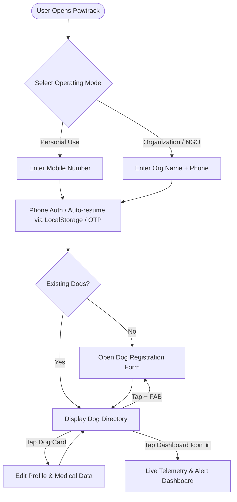
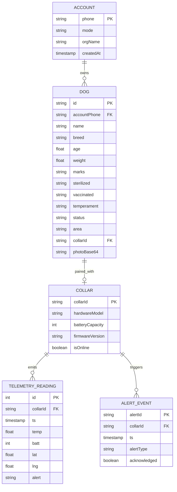
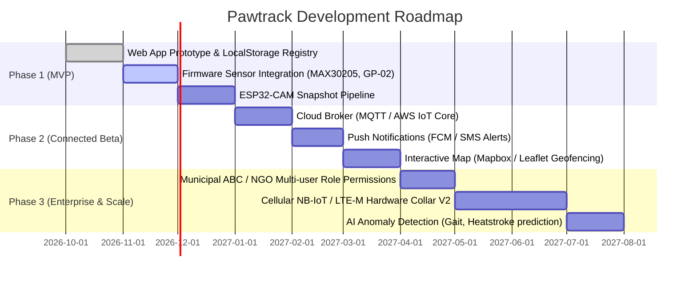

# Product Requirements Document (PRD)

## Project: Pawtrack — Smart Dog Collar & Welfare Management Platform
**Document Version:** 1.0.0  
**Status:** Approved for Implementation  
**Target Release:** MVP / v1.0  
**Last Updated:** November 2026  

---

## 1. Executive Summary & Vision

### 1.1 Executive Summary
**Pawtrack** is an IoT-enabled smart dog collar and companion digital platform designed for both individual pet owners and animal welfare organizations (NGOs, shelters, community caretakers, and municipal Animal Birth Control / ABC programs). 

By uniting precision biometric sensing (MAX30205 body temperature), satellite geolocation (GP-02 GPS), optical snapshot verification (ESP32-CAM), and a responsive management console, Pawtrack bridges the gap between domestic pet security and scalable stray/community dog population health monitoring.

### 1.2 Vision Statement
To eliminate lost dogs and unmonitored animal health crises by providing an affordable, ruggedized IoT collar coupled with a unified digital registry for household pets and community street dogs.

---

## 2. Problem Statement & Opportunity

### 2.1 Problem Statement
1. **Domestic Pet Vulnerabilities:**
   - Pets frequently wander or get lost without real-time tracking.
   - Acute medical emergencies (heatstroke, fever, canine parvovirus, infections) are often detected too late due to a lack of continuous biometric telemetry.
2. **Community & Street Dog Management Challenges (NGOs & Municipalities):**
   - High volume of street dogs with untracked vaccination (rabies) and sterilization (ABC) records.
   - Difficult physical identification of similar-looking dogs (indies/pariahs) in neighborhoods and territories.
   - Inability to quickly locate injured, aggressive, or missing dogs flagged by community members.
   - Manual, error-prone paper or spreadsheet logs that fail to scale across municipal sectors.

### 2.2 Market Opportunity
Existing pet smart collars (e.g., Fi, Whistle, Tractive) target affluent Western pet owners with high hardware costs ($100–$150) and steep recurring cellular subscriptions ($10–$15/month). They lack:
- Support for community animal welfare, multi-dog NGO fleet management, and sterilization/vaccination records.
- Low-cost, localized architectures suitable for emerging markets and large-scale NGO deployment.

---

## 3. Target Audience & Personas

| Persona | Role / Description | Primary Needs | Key Pain Points |
| :--- | :--- | :--- | :--- |
| **Pet Parent (Priya)** | Domestic dog owner residing in an urban area. | Real-time GPS location, health/fever alerts, battery status, lost dog recovery. | Anxiety over lost dog; vet visits delayed due to unnoticed early illness signs. |
| **NGO Field Worker (Rajesh)** | Works at an animal shelter / rescue organization. | Quick dog lookup by landmark, vaccination status verification, temperament notes. | Hard to track which street dogs were vaccinated or sterilized in which sector. |
| **Shelter / NGO Admin (Dr. Anita)** | Manages 100+ shelter and street dogs across districts. | Bulk collar management, fleet telemetry, health trends, data export for municipal reports. | Fragmented records, manual spreadsheets, lack of triage alerts. |

---

## 4. Product Modes & User Journey

Pawtrack supports a dual-mode experience tailored during initial onboarding:

---

## 5. Hardware Specifications & Architecture

### 5.1 Collar Hardware Specifications

| Component | Hardware Specification | Purpose / Function | Interface |
| :--- | :--- | :--- | :--- |
| **Primary MCU** | ESP32-WROOM-32 / ESP32-CAM | Dual-core 240MHz, Wi-Fi 802.11 b/g/n, BLE 4.2, deep-sleep capabilities | System control, sensor polling |
| **Temperature Sensor** | **MAX30205** Clinical Temperature Sensor | ±0.1°C accuracy (37°C to 39°C range), skin/body contact probe | I2C |
| **GPS / GNSS Module** | **Ai-Thinker GP-02** | High-sensitivity BDS/GPS satellite positioning, NMEA sentence parsing | UART (9600 baud) |
| **Camera Sensor** | **OV2640 (2 Megapixel)** | Periodic visual confirmation, remote lost-dog snapshot | DVP / Camera Interface |
| **Battery & Power** | **1200mAh LiPo (3.7V)** + TP4056 Charging IC | Rechargeable cell with voltage divider / fuel gauge monitoring | ADC / I2C |
| **Status Indicators** | RGB LED + Piezo Buzzer | Visual/audible pairing, SOS trigger, geofence alarm | GPIO |
| **Enclosure** | IP67 Waterproof / Rugged ABS/Polycarbonate casing with silicone skin contact pad | Water, mud, bite, and scratch resistance | Mechanical |

### 5.2 Power Consumption & Operational States

1. **Active Tracking Mode (Walking / Moving):**
   - GPS active every 30s, temperature polled every 60s, Wi-Fi/LTE uplink.
   - Current draw: ~80–120 mA (10–15 hours continuous).
2. **Standard Power-Save Mode (Resting / Home Zone):**
   - GPS in low-power standby; wake on accelerometer motion.
   - Uplink interval: Every 5–10 minutes.
   - Battery life: 3–5 days.
3. **Emergency / SOS Broadcast Mode:**
   - Continuous GPS uplink (every 5 seconds) and alert beaconing.

---

## 6. Functional Requirements

### 6.1 Mode Selection & Authentication
- **FR-AUTH-01:** System shall prompt user to choose between **"Personal use"** and **"Organization / NGO"**.
- **FR-AUTH-02:** If Organization is chosen, an organization name field must be required.
- **FR-AUTH-03:** Users log in using a 10-digit mobile phone number.
- **FR-AUTH-04:** Local device session persistence with instant auto-resume on re-launch.
- **FR-AUTH-05:** Multi-tenant segmentation: Profile data, collars, and telemetry are isolated by account identifier.

### 6.2 Dog Registry & Identity Management
- **FR-REG-01 (Profile Attributes):** Each dog profile must store:
  - Dog's Name (Required)
  - Breed / Type (with common presets: *Indian pariah / mixed, Labrador mix, German Shepherd mix, etc.*)
  - Age (in years, 0.5 step increments)
  - Weight (in kg, 0.1 step increments)
  - Distinguishing Physical Marks (text area for scars, coat pattern, ear notches)
  - Sterilization Status (ABC Programme: `Yes` / `No` / `Unknown`)
  - Rabies Vaccination Status (`Yes` / `No` / `Unknown`)
  - Temperament (`Friendly`, `Shy / cautious`, `Nervous`, `Can be aggressive`, `Unknown`)
  - Welfare Status (`On the street`, `Adopted`, `In shelter`, `Missing`)
  - Area / Landmark (geographical context, e.g. *Sector 62, behind Blue Gate dairy*)
  - Paired Smart Collar ID (e.g. `COLLAR-01`)
- **FR-REG-02 (Photo Upload & Processing):** 
  - Direct camera or photo library upload.
  - Client-side image crop, square aspect ratio normalization (96x96 px), and Base64 compression for lightweight offline storage.
- **FR-REG-03 (Status Badging):**
  - Instant visual indicators in lists:
    - *On the street* (Amber `#f0ad4e`)
    - *Adopted* (Emerald `#36c08a`)
    - *In shelter* (Cyan `#4aa3e0`)
    - *Missing* (Crimson `#ef6a6a`)

### 6.3 Real-Time Telemetry & Hardware Integration
- **FR-TEL-01 (Body Temperature Monitoring):**
  - Continuous reading from MAX30205 clinical sensor.
  - Normal canine range: 38.0°C – 39.2°C.
  - Automatic fever threshold: > 39.5°C triggers **"High body temperature"** warning.
  - Hypothermia threshold: < 37.2°C triggers low-temperature warning.
- **FR-TEL-02 (Battery Telemetry):**
  - Percentage computation from 1200mAh pack.
  - Low battery threshold: < 15% triggers **"Low battery"** alert.
- **FR-TEL-03 (GPS Geolocation):**
  - Real-time Latitude & Longitude reporting from GP-02.
  - Formatted coordinate presentation (5 decimal precision ~1.1 meter accuracy).
- **FR-TEL-04 (Camera Feed / Snapshot):**
  - Standby / Capture states for ESP32-CAM module to visually verify dog condition or surroundings.
- **FR-TEL-05 (Live Status Pulse):**
  - Dynamic connection dot (`green` = online/live, `red` = disconnected/offline).
  - Relative timestamp of last received packet.

### 6.4 Safety, Alerts & Incident Management
- **FR-ALT-01 (Rule-Based Alert Engine):**
  - Automatically tag readings with alert payloads when thresholds are crossed.
- **FR-ALT-02 (Emergency SOS Trigger):**
  - On-demand SOS triggering by user or collar panic hardware button.
  - Latches active emergency state for high-visibility response.
- **FR-ALT-03 (Alert Acknowledgment):**
  - User can acknowledge alerts from the dashboard (`Acknowledge` action), updating status without erasing historical incident logs.
- **FR-ALT-04 (Audit Trail):**
  - Timestamped alert history list showing alert type, time, and resolution status.

### 6.5 Interactive Visualizations & Data Analysis
- **FR-VIS-01 (Dynamic Temperature Wave):**
  - HTML5 Canvas real-time continuous sparkline/waveform.
  - Color gradient transition from cool blue (`#4aa3e0`) to critical red (`#ff6f6f`).
  - Alert points plotted as distinct red markers on the wave.
- **FR-VIS-02 (Time-Range Filtering):**
  - Telemetry log filtering presets: `1h`, `6h`, `24h`, and `All`.
- **FR-VIS-03 (Historical Log Table):**
  - Paginated / scrollable audit table containing: `Time`, `°C`, `Batt %`, `Lat`, `Lng`, and `Alert Details`.
- **FR-VIS-04 (Data Export):**
  - One-click CSV export (`collar-readings.csv`) with full telemetry payload for offline veterinary diagnosis or municipal compliance reporting.

---

## 7. Data Model & Storage Specifications

### 7.1 Entity Relationship Diagram

---

## 8. Non-Functional Requirements (NFRs)

### 8.1 Performance & Responsiveness
- **NFR-PERF-01:** Telemetry dashboard updates must render within < 100ms of payload arrival.
- **NFR-PERF-02:** Client-side canvas wave re-rendering must maintain 60 FPS without UI jank.
- **NFR-PERF-03:** App bundle footprint must remain lightweight (< 150KB compressed) to ensure instant loading over 2G/3G field connections.

### 8.2 Reliability & Offline First
- **NFR-REL-01:** When mobile network connectivity drops, the collar must cache up to 1,000 readings locally in non-volatile flash (SPIFFS / LittleFS) and upload upon reconnection.
- **NFR-REL-02:** Local client storage must retain profiles and cached telemetry locally via Web Storage / IndexedDB so field workers can review data without internet.

### 8.3 Security & Privacy
- **NFR-SEC-01:** All sensor-to-cloud telemetry transmission must be encrypted using TLS 1.3 / HTTPS / MQTTS.
- **NFR-SEC-02:** Personally Identifiable Information (owner mobile numbers, residential addresses) must not be broadcast over unencrypted BLE beacons.

### 8.4 Usability & Accessibility
- **NFR-UX-01:** Responsive, mobile-first design optimized for one-handed operation on low-cost Android smartphones.
- **NFR-UX-02:** Complete dark and light theme support with persistent user preferences.
- **NFR-UX-03:** Touch target sizes strictly adhere to minimum 44x44 px guidelines for outdoor field usability.

---

## 9. Implementation Roadmap

---

## 10. Key Performance Indicators (KPIs)

1. **Lost Dog Recovery Time:** < 2 hours average recovery time for reported lost dogs.
2. **Early Health Triage Rate:** > 80% of canine fever/hyperthermia spikes detected before visible clinical lethargy.
3. **NGO Operational Efficiency:** 50% reduction in paper record lookups for street dog ABC sterilization and rabies drives.
4. **Collar Uptime:** > 99.5% sensor telemetry uptime during active outdoor shifts.
5. **Battery Longevity:** Minimum 72 hours operating time per charge in power-save mode.

---

## 11. Appendix: Hardware Component Bill of Materials (BoM Estimate)

| Item | Component | Est. Unit Cost (USD) | Function |
| :--- | :--- | :--- | :--- |
| 1 | ESP32-CAM AI-Thinker Module | \$4.50 | Core Processing, Wi-Fi/BT, Camera Host |
| 2 | MAX30205 Human Body Temp Board | \$2.80 | Precision Clinical Contact Temperature |
| 3 | Ai-Thinker GP-02 GNSS Module | \$3.20 | Satellite Location Tracking |
| 4 | 3.7V 1200mAh LiPo Rechargeable Cell | \$2.50 | Power Source |
| 5 | TP4056 USB-C Charge Management Board | \$0.40 | Charging & Battery Protection |
| 6 | Custom Collar Strap + IP67 3D Printed Housing | \$2.00 | Wearable Enclosure & Water Resistance |
| **Total** | **Estimated Hardware Prototype BoM** | **~\$15.40** | *Fraction of traditional commercial collars* |

